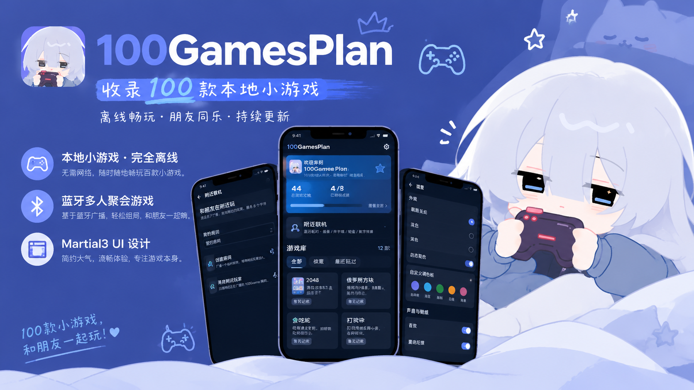

# 100Games Plan · 100游戏计划

  

[下载最新版 APK](https://github.com/S1LENCE-D/100games-plan/releases/latest)

100Games Plan 是一款使用 Kotlin + Jetpack Compose + Material 3 构建的原生 Android 小游戏合集。大部分游戏使用 Compose Canvas、手势与协程实现；「吃掉小猫猫」是本地打包的离线网页音游，通过 WebView 集成并由原生层读取网页得分与 CPS。

游戏库会持续扩展，目标是收录 100 款轻量小游戏。

## 当前内容

- 附近联机（实验性）：通过蓝牙 BLE 广播发现附近设备，支持双人石头剪子布、井字棋、虚拟轮盘和 3–6 人数字炸弹。
- 已可玩：2048、俄罗斯方块、贪吃蛇、打砖块、扫雷、记忆翻牌、数独、井字棋、数字华容道、反应力挑战、谷歌小恐龙、吃掉小猫猫（本地网页版）
- 收藏、最近游玩、最高分、成就与随机开一局
- 游戏音效与震动反馈
- 首次进入教程，之后可直接开局
- 得分与最高分展示在屏幕顶部
- 贪吃蛇可自定义滑动/按键、按键左右手位置与大小
- 可在设置中关闭预见性返回手势
- Material 3 主题、自定义调色板、深色/浅色与动态取色
- 完全离线，游戏数据保存在本机

## 技术栈

- Kotlin
- Jetpack Compose
- Material 3
- MVVM + UDF
- Navigation Compose
- DataStore

更多小游戏会持续加入。
